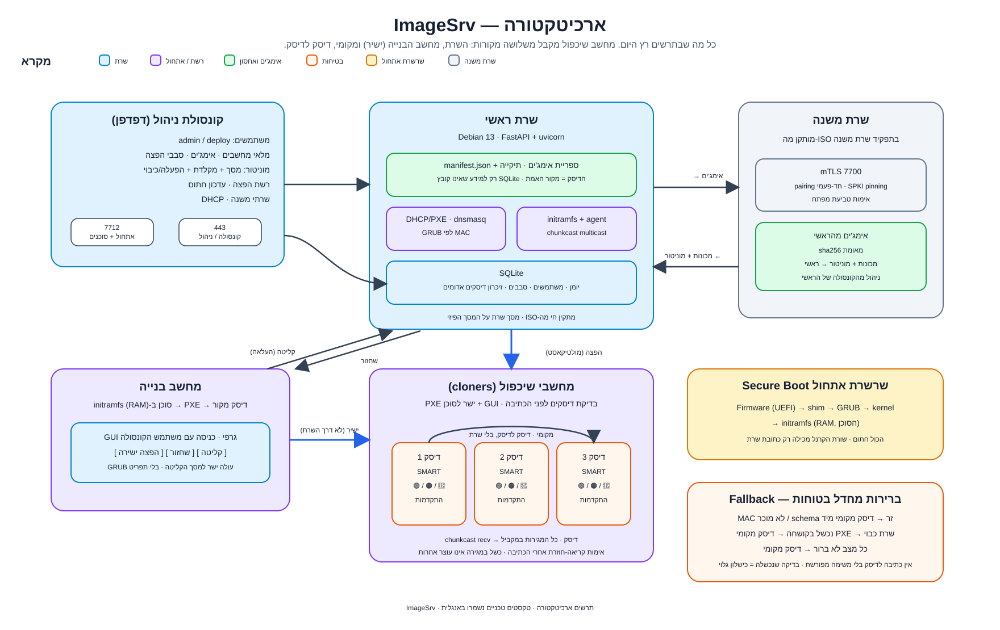
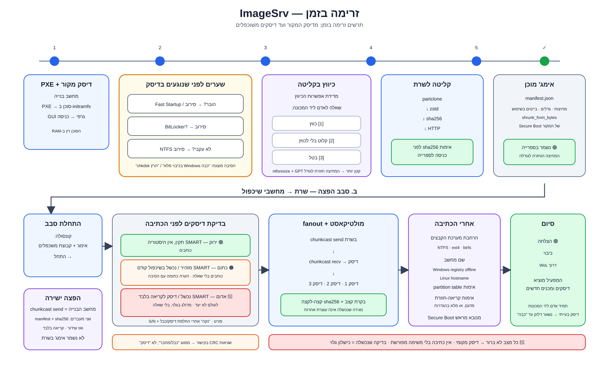
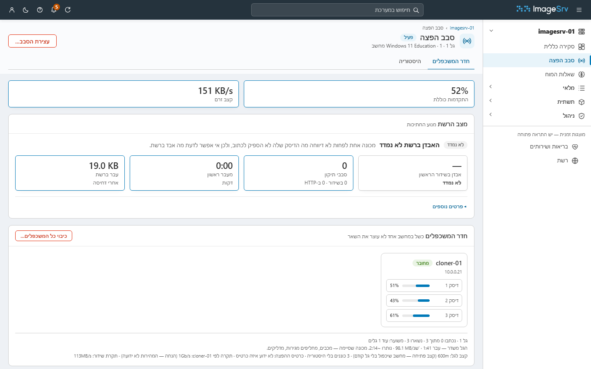
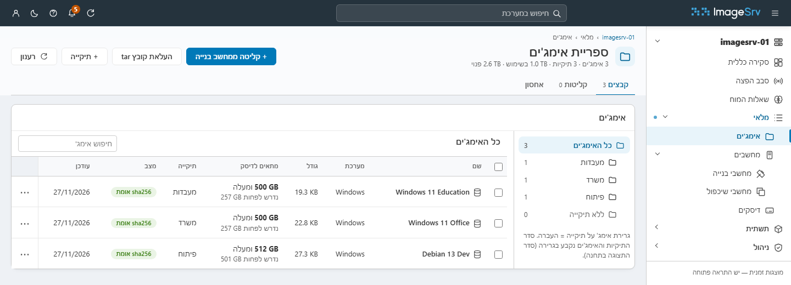
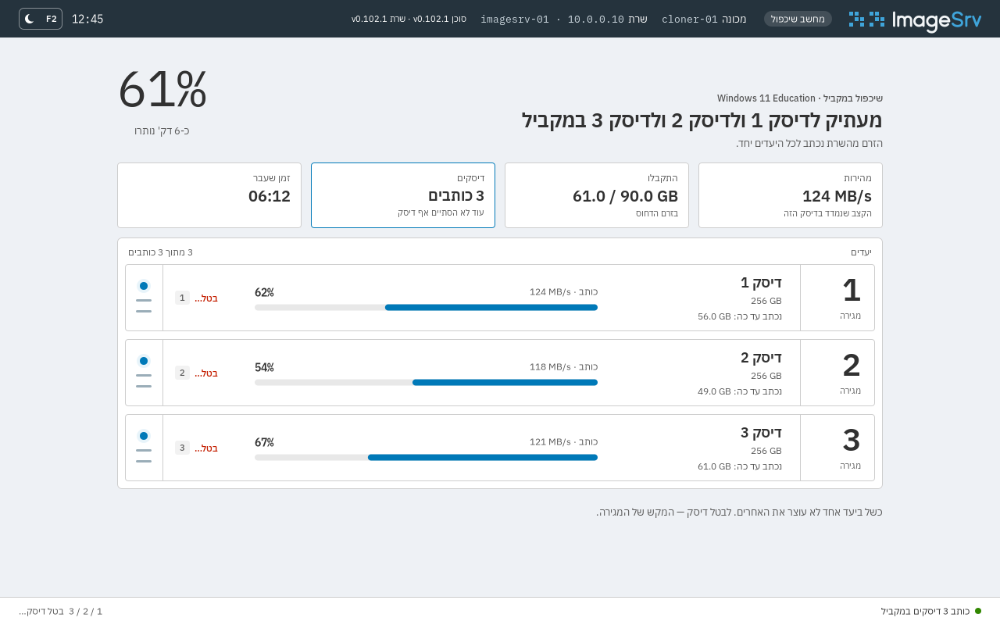
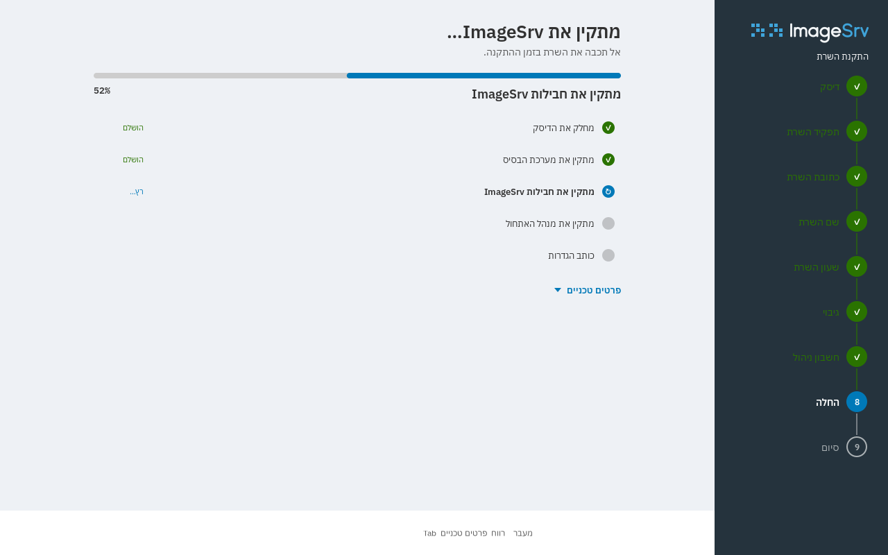
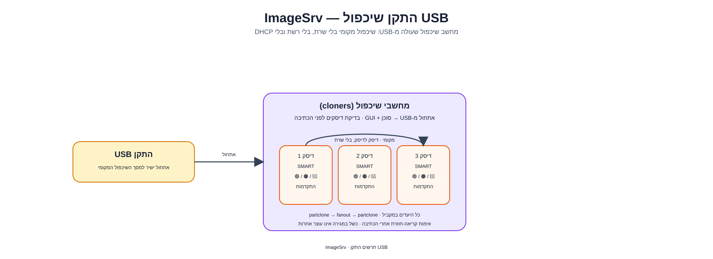

<div align="center">

<picture>
  <source media="(prefers-color-scheme: dark)" srcset="docs/brand/logo-lockup-dark.svg">
  
</picture>

**שרת אימג'ים ופריסה למחשבים במכללות ובמעבדות**

[](https://github.com/NadavOked/ImageSrv/actions/workflows/tests.yml)
[](https://github.com/NadavOked/ImageSrv/actions/workflows/codeql.yml)
[](https://scorecard.dev/viewer/?uri=github.com/NadavOked/ImageSrv)
[](https://codecov.io/gh/NadavOked/ImageSrv)
[](https://github.com/NadavOked/ImageSrv/releases/latest)
[](LICENSE)


</div>

<div dir="rtl">

בפיתוח פעיל · בשימוש במעבדה · [הגרסה האחרונה (ISO ו-USB להורדה)](https://github.com/NadavOked/ImageSrv/releases/latest)

ImageSrv קולט אימג'י דיסק, מפיץ אותם במולטיקאסט לכל מחשבי השיכפול במקביל,
ומנהל את הספרייה, הגרסאות והסבבים מקונסולה אחת בעברית.

זמן השידור אינו גדל עם מספר המחשבים ברשת: אותו זרם נכתב לכולם במקביל. הוא כן תלוי בכונן האיטי ביותר ובמספר הכוננים שמקבלים (ראו [ביצועים](#ביצועים)).

</div>

<picture>
  <source media="(prefers-color-scheme: dark)" srcset="docs/architecture-v1-dark.svg">
  
</picture>

<picture>
  <source media="(prefers-color-scheme: dark)" srcset="docs/flow-v1-dark.svg">
  
</picture>

<div dir="rtl">

## תוכן

- [רכיבים](#רכיבים)
- [זרימות](#זרימות)
- [תפקידי הרכיבים](#תפקידי-הרכיבים)
- [הקונסולה](#הקונסולה)
- [עקרונות בטיחות](#עקרונות-בטיחות)
- [תמיכה ב-Secure Boot](#תמיכה-ב-secure-boot)
- [התקן שיכפול USB](#התקן-שיכפול-usb)
- [התקנה](#התקנה)
- [רשת ופורטים](#רשת-ופורטים)
- [ביצועים](#ביצועים)
- [בדיקות](#בדיקות)
- [אבטחה](#אבטחה)
- [מבנה הריפו](#מבנה-הריפו)
- [רישיון](#רישיון)

---

## רכיבים

| רכיב | תפקיד |
|------|--------|
| **שרת** | מחזיק את ספריית האימג'ים (תיקייה עם `manifest.json` לכל אימג'; הדיסק הוא מקור האמת), מגיש את הקונסולה ומתזמר סבבים. ניתן לצרף שרת משנה; הראשי תמיד יוזם בערוץ mTLS. |
| **מחשב בנייה** | קולט אימג' מדיסק (דחוס, בלוקים תפוסים בלבד, עם אימות `sha256`), משחזר אימג' מהשרת לדיסק שלו, ומשדר ישירות למחשבי שיכפול. |
| **מחשבי שיכפול** | מחשבים עם מספר מגירות. כותבים את הזרם במקביל לכל המגירות, עם בדיקת SMART לפני הכתיבה ואימות אחריה. |

השידור למחשבי השיכפול הוא מנוע החתיכות, Trident: שולח שאינו מחכה לאישורים, תיקון של מה שחסר בנפרד, ואימות כל חתיכה לפני שהיא נכתבת. הפרוטוקול מוסבר ב-[docs/architecture/trident.md](docs/architecture/trident.md).

המחשבים עולים ב-PXE ומקבלים הוראות מהשרת. Windows ולינוקס נתמכים באותו מסלול ובאותו מניפסט (`partclone.ntfs`, `partclone.ext4` או `partclone.btrfs`), כולל הרחבה/כיווץ של המחיצה האחרונה וכתיבת שם מחשב לפני האתחול הראשון.

## זרימות

מחשב שיכפול יכול לקבל משלושה מקורות: השרת (הפצה), מחשב הבנייה (ישיר), או מקומי (דיסק לדיסק).

| זרימה | מי למי | מה קורה |
|--------|--------|---------|
| **קליטה** | בנייה ← שרת | הקונסולה מזמינה קליטה. מחשב הבנייה קורא את הדיסק ומעלה לשרת בזרם. השרת מאמת `sha256` לפני הכנסה לספרייה. מחיצת NTFS במצב שינה יכולה להיקלט דרך עותק זמני בזיכרון ([`captureview.sh:capture_prepare_views`](agent/lib/capture/captureview.sh#L23)). כרך BitLocker מועתק סקטור־אחר־סקטור, בלי פענוח ובלי כיווץ, ונרשם במניפסט כ-`fs: "BitLocker"`. אם בדיקת ה-BitLocker נכשלת, הקליטה נעצרת לפני תחילת ההעלאה ([`capture.sh:capture_disk`](agent/lib/capture/capture.sh#L42), [`hibernation.sh:capture_bitlocker_gate`](agent/lib/capture/hibernation.sh#L77)). רק מחשב בנייה מעלה אימג' לשרת. |
| **שחזור** | שרת ← בנייה | מחשב הבנייה בוחר אימג' מהספרייה וכותב אותו לדיסק הפנימי שלו. |
| **הפצה** | שרת ← מחשבי שיכפול | סבב מולטיקאסט אחד לקבוצה. מחשב שעולה מצטרף; השידור מתחיל כשכולם הגיעו, כשעבר הזמן מהמצטרף האחרון, או בלחיצה. גלים כשיש יותר מגירות ממקום. מחשב שיכפול יכול גם לפתוח סבב לעצמו מהמסך שלו. |
| **ישיר** | בנייה ← מחשבי שיכפול | שידור ישיר מדיסק הבנייה. הזרם לא עובר בשרת; השרת רק מתזמר. חתיכות שלא הגיעו נמשכות ב-HTTP ממחשב הבנייה. |
| **מקומי** | מחשב שיכפול, דיסק לדיסק | העתקה מדיסק מקור לדיסקים אחרים באותו מחשב, בלי שרת. המקור לעולם אינו נכתב. התקן ה-USB מריץ זרימה זו ללא רשת. |

בכל הזרימות: מגירה שנכשלה מדווחת **בשמה** ובלי לעצור את השאר. כל יעד שנכתב נקרא בחזרה (במדגם או במלואו) ומושווה לאימג'. כונן שנכשל ב-SMART אינו נכתב; כונן חשוד נכתב עם הערה שמסבירה למה.

## תפקידי הרכיבים

| מחשב | יכולות עיקריות |
|------|----------------|
| **שרת ראשי** | ספריית אימג'ים עם אימות `sha256` · סבבי מולטיקאסט · קונסולה בעברית · DHCP/PXE ותפריט GRUB לפי MAC · WoL · מוניטור · ניהול שרתי משנה · עדכון חתום · החלטות אוטומטיות ("המוח") על קצב השידור ותיקון חתיכות |
| **שרת משנה** | הפצה, DHCP/PXE ו-WoL לאתר שלו · דיווח לראשי · ניהול מהקונסולה של הראשי |
| **מחשב בנייה** | קליטה והעלאה לשרת · שחזור מהשרת · שידור ישיר למשכפלים |
| **מחשב שיכפול** | קבלה מהשרת או מהבנייה · שיכפול מקומי · בדיקת SMART · אימות קריאה-חוזרת · פתיחת סבב עצמי |
| **התקן USB** | אתחול ישיר למסך שיכפול מקומי, בלי רשת ובלי שרת |

פירוט פורטים: [רשת ופורטים](#רשת-ופורטים).

## הקונסולה

עברית, RTL, מצב בהיר וכהה, ב-HTTPS על כרטיס הניהול.

- **סקירה, אימג'ים ומגירות** — ספרייה, סבב חי עם התקדמות לכל מחשב ולכל כונן, ודיווח כשלים בשם.
- **בריאות, רשת ואחסון** — שירותים מאזינים, כרטיסי רשת, דף השירותים, חיפוש גלובלי.
- **שרתים** — עץ ראשי/משני, אותם דפים בכל שרת.
- **שאלות המוח** — כשהשרת צריך הכרעה של אדם הוא שואל בקונסולה (ובמסך המכונה, כשהשאלה שלה). שאלה שלא נענתה מסתיימת בברירת מחדל בטוחה.
- **הגדרות, משתמשים ועדכון** — תעודת TLS, שם מארח, הרשאות (מנהל / משתמש הפצה), עדכון חתום לגרסה שמפתח השרת מכיר.
- **מוניטור** — צפייה ב-GUI של מחשב בנייה או שיכפול (כבוי כברירת מחדל).
- **יומן בעברית** — הודעות קריאות ("כתיבה נכשלה במחשב: 06"), לא שורות לוג גולמיות.

סבב הפצה חי: התקדמות כוללת, קצב הזרם, וכל כונן של מחשב השיכפול בנפרד.

<picture>
  <source media="(prefers-color-scheme: dark)" srcset="docs/screenshots/round-dark.png">
  
</picture>

ספריית האימג'ים: תיקיות, התאמה לדיסק, ואימות sha256 לכל אימג'.

<picture>
  <source media="(prefers-color-scheme: dark)" srcset="docs/screenshots/images-dark.png">
  
</picture>

מסך ההתקדמות במחשב השיכפול: כל כונן בנפרד, עם אחוזים וקצב.

<picture>
  <source media="(prefers-color-scheme: dark)" srcset="docs/screenshots/cloner-dark.png">
  
</picture>

מסך ההתקנה של השרת מה-ISO.

<picture>
  <source media="(prefers-color-scheme: dark)" srcset="docs/screenshots/install-dark.png">
  
</picture>

*צילומי המסך נלקחו מהקונסולה ומהגואי שנבנו מקומית, עם נתוני דוגמה (שמות וכתובות כלליים).*

## עקרונות בטיחות

**ברירת המחדל היא תמיד אתחול מהדיסק המקומי.**
מחשב בלי משימה, MAC לא מוכר, שרת שלא עונה, גרסת ממשק לא מוכרת או חריגה בקוד — כולם מסתיימים באתחול רגיל מהדיסק. שרת שנפל אינו משבית מחשבים, ומחשב אינו יכול "למחוק את עצמו" במפתיע.
ברשת שהשרת מפיץ בה אימג'ים, MAC לא מוכר וגרסת ממשק לא מוכרת מציגים קודם מסך כישלון עם כפתור "אתחל עכשיו", בלי לגעת בדיסק ([מודל האמון](docs/architecture/security-model.md), סעיף 4).

**פעולה שלא הצליחה לבדוק — נכשלת, לא מוותרת.**
הצלחה נקבעת לפי ראיה חיובית (קוד תשובה, מונה, ערך שנקרא בחזרה), לא לפי היעדר סימן כישלון. פעולות הרסניות בקונסולה דורשות אישור מפורש עם פירוט ההשלכות.

**אימג' נושא את מה שהיה על מחשב המקור.**
קליטה מעתיקה את הדיסק כמות שהוא: מפתחות מארח של SSH, היסטוריית מעטפת, סיסמאות ואישורים שמורים, ומזהה המכונה. מכינים את מחשב המקור לפני הקליטה (Sysprep ב-Windows; ניקוי מפתחות המארח, ההיסטוריה ו-`machine-id` בלינוקס), אחרת כל מחשב משוכפל יישא אותם.

## תמיכה ב-Secure Boot

```text
firmware → shim (Microsoft-signed) → GRUB (Debian-signed) → distro kernel → initramfs
                                                                            ^ הסוכן, בלי חתימה
```

Secure Boot מאמת את השרשרת עד הקרנל בלבד. ה-initramfs וקובץ התצורה של GRUB **אינם נבדקים בחתימה**, ובמחשבי Legacy BIOS אין אימות כלל: האמון בהם נשען על בידוד רשת ההפצה. עדכון הסוכן הוא החלפת קובץ אחד. מה מאומת ומה לא: [מודל האמון](docs/architecture/security-model.md).
GRUB מושך קובץ תצורה שמיוצר בזמן אמת לפי ה-MAC. פרטי משימה אינם עוברים בשורת הפקודה של הקרנל — הכול מגיע מהשרת בערוץ מתועד ([docs/architecture/interfaces.md](docs/architecture/interfaces.md)).

## התקן שיכפול USB

<picture>
  <source media="(prefers-color-scheme: dark)" srcset="docs/usb-clone-dark.svg">
  
</picture>

התקן USB שמאתחל מחשב ישירות למסך השיכפול המקומי: בלי רשת, בלי שרת ובלי DHCP.
ההתקן עצמו אינו מוצע כמקור או כיעד. הגדרות ודוחות נשמרים במחיצת הנתונים שלו.

הורדה מהקונסולה וכתיבה ל-USB עם Rufus במצב DD (או `dd` בלינוקס).
הוראות: `tools/build_usb_clone.sh` ו-[docs/guides/local-clone.md](docs/guides/local-clone.md).

## התקנה

**התקנת שרת נתמכת מה-ISO או מה-USB בלבד** (מתקין גרפי על מסך השרת). אין התקנה ברשת ואין התקנה על דביאן קיים.
המדריך המלא, כולל שרת משני: [docs/guides/server-install.md](docs/guides/server-install.md).

רשת ההפצה מוגדרת מהקונסולה (דף הרשת).

**עדכון** — "בדוק עכשיו" ו"החל עדכון" בהגדרות, בכרטיס "עדכונים ותחזוקה". העדכון מתבצע רק לתג חתום במפתח המותקן בשרת (`deploy/release-signers`).

**הרצת פיתוח** (לא לייצור):

```bash
pip install -r server/requirements.txt
python -m server.main --server-url https://127.0.0.1:7712 --data-dir <tmp> --images <tmp>
```

בניית הסוכן (initramfs) על מכונת Debian:

```bash
sudo ./tools/build_initramfs.sh
```

יחידת systemd ופריסה: [docs/architecture/server.md](docs/architecture/server.md).

## רשת ופורטים

הטבלה נגזרת ממה שהמערכת באמת פותחת (`server/net/ports.py`, `deploy/nftables-rules.sh`). הפורטים עצמם מוגדרים במקום אחד, `server/core/ports.py` (‏#3871: הטווח 77xx, לפי וילן).
דף "שירותים" בקונסולה (רשת ← שירותים, #3887) מציג את אותם שירותים, עם חלון אישור לפני כיבוי. רק פורט הקונסולה ניתן לעריכה.
מולטיקאסט, משוב הקצב ושרתי החתיכות של ההפצה הישירה אינם מאזינים קבועים: הם נפתחים לכל שידור. חומת האש פותחת את שני הפורטים של Trident (‏7713–7714) רק למחשבים רשומים (`deploy/nftables-rules.sh`).

| שירות | פורט | היכן | הערה |
|---|---|---|---|
| HTTP — GRUB, קרנל, initrd (`/boot`) | 7711/tcp | וילן ההפצה | HTTP בלבד (GRUB החתום ללא TLS); מאזין משלו, והשירות היחיד שפתוח גם למחשב לא רשום |
| HTTPS — API סוכן, משיכת אימג' | 7712/tcp | וילן ההפצה | תעודה של CA פר-שרת, שה-initrd נושא; מחשב לא רשום מקבל רק hello |
| HTTPS — קונסולה | 443/tcp | כרטיס הניהול בלבד | תעודה חתומה-עצמית; HTTP אינו מוגש |
| mTLS — ערוץ בין-שרתי | 7700/tcp | בין אתרים, מכתובת הראשי בלבד | הראשי תמיד יוזם |
| TFTP — bootloader | 69/udp | וילן ההפצה | מתג בקונסולה |
| DHCP | 67/68/udp | וילן ההפצה | ברודקאסט מקומי |
| PXE proxy | 4011/udp | וילן ההפצה | רק כשה-DHCP אינו שלנו |
| מולטיקאסט — מנוע החתיכות | 7713/udp | וילן ההפצה בלבד | ‏Trident: נתונים לקבוצה `239.84.82.1` |
| משוב קצב — מנוע החתיכות | 7714/udp | וילן ההפצה בלבד | ‏Trident: הבקרה, שאליה המשכפלים שולחים את המשוב; נפתח רק למחשבים רשומים |
| הפצה ישירה — משיכת חתיכות | 7720–7729/tcp | מחשב הבנייה, וילן ההפצה | HTTP; רק עם האסימון של הסבב. פורט לכל מחיצה לפי סדר השליחה (הראשונה ב-7720); השרת קובע את המיפוי ומוסר אותו למחשב הבנייה (`serve_ports`), ויותר מ-10 מחיצות לשלוח מסורב בשמו |
| WoL | 9/udp | וילן ההפצה | ברודקאסט מקומי |
| מוניטור | 7710/tcp | שרת → תחנות | כבוי כברירת מחדל |
| שכנים ב-P2P (`chunkcast serve`) | 7717–7718/tcp | משכפל → משכפל, וילן ההפצה | רק עם האסימון של הסבב |

**הפרדת וילנים:** הקונסולה (443) על וילן הניהול; ערוץ התחנות (7711, 7712, DHCP, TFTP, מולטיקאסט, משוב הקצב) על וילן ההפצה בלבד.

**דרישות סוויץ' (חובה לפני פרודקשן):** וילן הפצה נפרד ללא ניתוב, Port security, IGMP snooping + querier, DHCP snooping, ללא 802.1X על פורטי ההפצה.
פירוט מלא: [docs/guides/server-install.md](docs/guides/server-install.md) ו-`deploy/firewall-rules.md`.

> הערה: האתחול מהרשת (7711) הוא HTTP גלוי: התפריט, הקרנל וה-initrd עוברים בלי הצפנה ובלי אימות. ערוץ התחנות (7712) הוא HTTPS, והסוכן מאמת את השרת מול ה-CA שנצרב ב-initrd. הקונסולה והערוץ הבין-שרתי מוצפנים. נתוני המולטיקאסט גלויים לכל מצטרף לקבוצה — בתכנון.

## ביצועים

מספרי מדידה אינם מתפרסמים בשלב זה.

אותו זרם נכתב לכל המחשבים במקביל, והזמן נקבע לפי הכונן האיטי ביותר. מגירה נוספת באותו מחשב מוסיפה זמן.

## בדיקות

```bash
python -m pytest tests -q
IMAGESRV_REQUIRE_NATIVE=1 python -m pytest tests -q   # דילוג = כישלון
python tools/e2e_simulation.py                        # לולאה מלאה מול שרת רץ
```

הבדיקות רצות על Python 3.12 ו-3.13 (כולל בדיקות הכותב המקבילי שדורשות gcc).
היעד: אפס דילוגים לא-מוצהרים.

## דיווח על באגים

כאן מדווחים על באגים. הפיתוח מתנהל בנפרד, ולא מתקבלים כאן PRs או בקשות יכולת. חולשת אבטחה מדווחים בפרטיות לפי [SECURITY.md](SECURITY.md).

<div dir="ltr">

**Reporting bugs:** this repository takes bug reports. Development happens separately, and pull requests or feature requests are not accepted here. Report a security vulnerability privately, as described in [SECURITY.md](SECURITY.md).

</div>

## אבטחה

המערכת כותבת לדיסקים ומאתחלת מחשבים.
דיווח על חולשה: [SECURITY.md](SECURITY.md)
Issue בריפו הפרטי מותר; פרסום לציבור לפני תיקון אסור.

בפריסה: הקונסולה (443, HTTPS) על וילן השרתים בלבד; ערוץ התחנות והמולטיקאסט על וילן ההפצה בלבד.

**מודל האמון:** ערוץ התחנות (7712) מוצפן, והסוכן מאמת את השרת מול ה-CA של השרת הזה, שנצרב ב-initrd (אימות CA ושם, לא הצמדה של תעודה: העלה מתחדש והתחנות אינן צריכות עדכון). מה שעדיין גלוי או אינו מאומת קריפטוגרפית: האתחול מהרשת (7711), כלומר ה-grub.cfg, הקרנל וה-initramfs, וה-CA שבתוכו; זרם המולטיקאסט; וזהות התחנה מול השרת (MAC וחכירת DHCP). מי ששולט בנתיב של 7711 יכול להחליף את ה-initramfs ואת ה-CA שבו, ולכן מי שמחובר לוילן ההפצה עדיין נמצא בתוך גבול האמון, ווילן הפצה סגור הוא דרישת פריסה, לא המלצה. בידוד הרשת אינו תחליף לאימות. מה מוגן, מה לא, מה קורה כשאימות נכשל ואיך כל פער נסגר: [docs/architecture/security-model.md](docs/architecture/security-model.md).

## מבנה הריפו

| נתיב | תפקיד |
|---|---|
| [docs/README.md](docs/README.md) | דף הכניסה לתיעוד: מה יש ב-`docs/` |
| [docs/architecture/imagesrv-spec.md](docs/architecture/imagesrv-spec.md) | אפיון המערכת — מה, למה, ובאילו אילוצים |
| [docs/architecture/interfaces.md](docs/architecture/interfaces.md) | חוזה בין הרכיבים — מקור האמת |
| [docs/architecture/server.md](docs/architecture/server.md) | שרת וקונסולה, כולל פריסה כשירות |
| [docs/architecture/agent.md](docs/architecture/agent.md) | סוכן: החלטות, שחזור, קליטה, חדר שיכפולים |
| [docs/architecture/grub-generator.md](docs/architecture/grub-generator.md) | מחולל תפריט GRUB |
| [docs/architecture/security-model.md](docs/architecture/security-model.md) | מודל האמון: מה מאומת באתחול ובמשימה, ומה לא |
| [docs/architecture/trident.md](docs/architecture/trident.md) | Trident, מנוע השידור: חבילות, משוב קצב, תיקון חסרים ואימות |
| [docs/guides/server-install.md](docs/guides/server-install.md) | התקנת שרת |
| [docs/guides/driver-packages.md](docs/guides/driver-packages.md) | חבילות דרייברים |
| [docs/guides/local-clone.md](docs/guides/local-clone.md) | שיכפול מקומי והתקן USB |
| [docs/guides/troubleshooting.md](docs/guides/troubleshooting.md) | שאלות נפוצות ותקלות: PXE, IGMP, Secure Boot, BitLocker, דיסק איטי, שרת שקט |
| [SECURITY.md](SECURITY.md) | דיווח על חולשה |
| `server/` | API, קונסולה, לוגיקה |
| `agent/` | סוכן + סקריפטי initramfs |
| `boot/` | מחולל תפריט GRUB |
| `deploy/` | systemd, firewall, מפתחות חתימה, הקמה |
| `installer/` | אשף התקנה |
| `tools/` | build, ISO, USB, e2e |
| `tests/` | בדיקות |
| `native-gui/` | ממשק נייטיב |

## רישיון

[MIT](LICENSE)


הריפו הזה הוא פרסום של גרסאות. הפיתוח השוטף וההיסטוריה המלאה מתנהלים בריפו נפרד.

</div>
