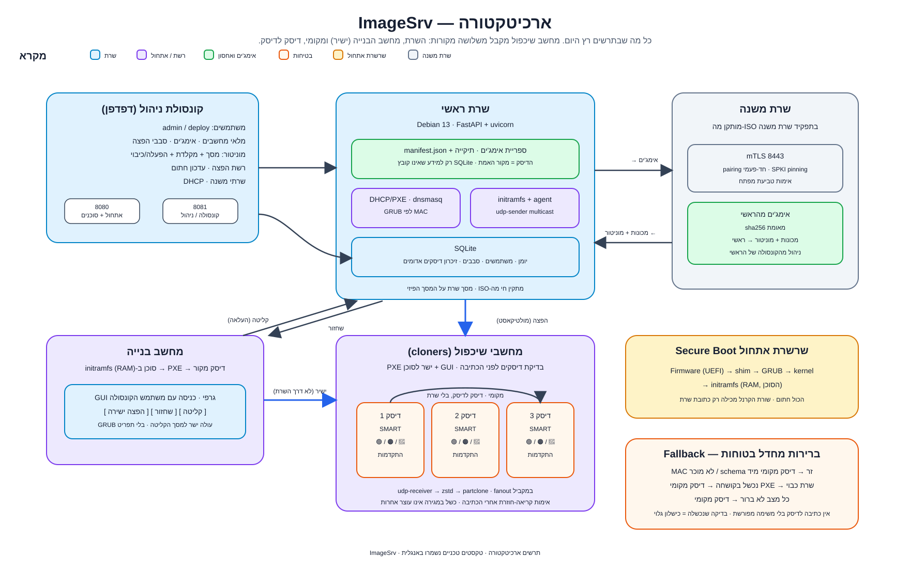
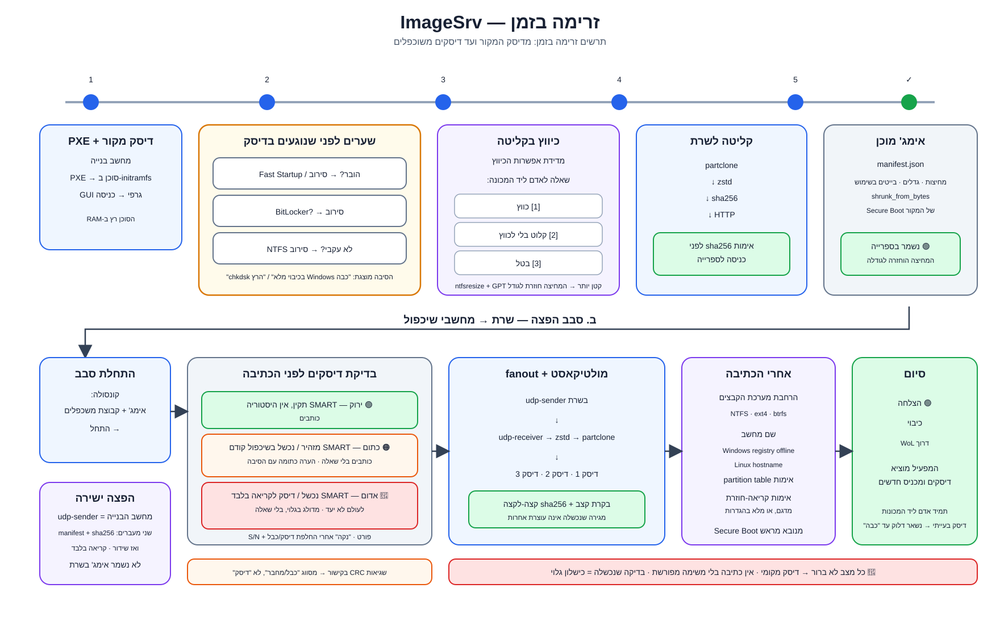
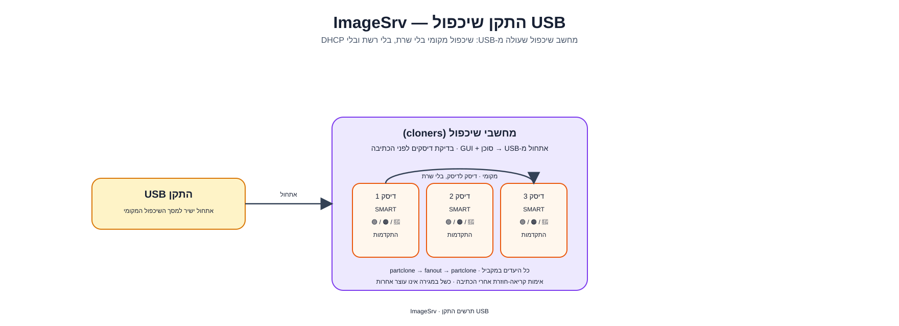

<div align="center">

<picture>
  <source media="(prefers-color-scheme: dark)" srcset="docs/brand/logo-lockup-dark.svg">
  
</picture>

**שרת אימג'ים ופריסה למחשבים במכללות ובמעבדות**

</div>

<div dir="rtl">

ImageSrv קולט אימג'י דיסק, מפיץ אותם במולטיקאסט לכל מחשבי השיכפול במקביל,
ומנהל את הספרייה, הגרסאות והסבבים מקונסולה אחת בעברית.

זמן השידור אינו תלוי במספר המחשבים.

</div>

<picture>
  <source media="(prefers-color-scheme: dark)" srcset="docs/architecture-v1-dark.svg">
  
</picture>

<picture>
  <source media="(prefers-color-scheme: dark)" srcset="docs/flow-v1-dark.svg">
  
</picture>

<div dir="rtl">

## תוכן

- [רכיבים](#רכיבים)
- [זרימות](#זרימות)
- [תפקידי הרכיבים](#תפקידי-הרכיבים)
- [הקונסולה](#הקונסולה)
- [עקרונות בטיחות](#עקרונות-בטיחות)
- [תמיכה ב-Secure Boot](#תמיכה-ב-secure-boot)
- [התקן שיכפול USB](#התקן-שיכפול-usb)
- [התקנה](#התקנה)
- [רשת ופורטים](#רשת-ופורטים)
- [ביצועים](#ביצועים)
- [בדיקות](#בדיקות)
- [אבטחה](#אבטחה)
- [מבנה הריפו](#מבנה-הריפו)
- [רישיון](#רישיון)

---

## רכיבים

| רכיב | תפקיד |
|------|--------|
| **שרת** | מחזיק את ספריית האימג'ים (תיקייה עם `manifest.json` לכל אימג'; הדיסק הוא מקור האמת), מגיש את הקונסולה ומתזמר סבבים. ניתן לצרף שרת משנה; הראשי תמיד יוזם בערוץ mTLS. |
| **מחשב בנייה** | קולט אימג' מדיסק (דחוס, בלוקים תפוסים בלבד, עם אימות `sha256`), משחזר אימג' מהשרת לדיסק שלו, ומשדר ישירות למחשבי שיכפול. |
| **מחשבי שיכפול** | מחשבים עם מספר מגירות. כותבים את הזרם במקביל לכל המגירות, עם בדיקת SMART לפני הכתיבה ואימות אחריה. |

המחשבים עולים ב-PXE ומקבלים הוראות מהשרת. Windows ולינוקס נתמכים באותו מסלול ובאותו מניפסט (`partclone.ntfs`, `partclone.ext4` או `partclone.btrfs`), כולל הרחבה/כיווץ של המחיצה האחרונה וכתיבת שם מחשב לפני האתחול הראשון.

## זרימות

מחשב שיכפול יכול לקבל משלושה מקורות: השרת (הפצה), מחשב הבנייה (ישיר), או מקומי (דיסק לדיסק).

| זרימה | מי למי | מה קורה |
|--------|--------|---------|
| **קליטה** | בנייה ← שרת | הקונסולה מזמינה קליטה. מחשב הבנייה קורא את הדיסק ומעלה לשרת בזרם. השרת מאמת `sha256` לפני הכנסה לספרייה. Windows שלא כובה בכיבוי מלא או שמוצפן ב-BitLocker נדחה לפני שנוגעים בדיסק. רק מחשב בנייה מעלה אימג' לשרת. |
| **שחזור** | שרת ← בנייה | מחשב הבנייה בוחר אימג' מהספרייה וכותב אותו לדיסק הפנימי שלו. |
| **הפצה** | שרת ← מחשבי שיכפול | סבב מולטיקאסט אחד לקבוצה. מחשב שעולה מצטרף; השידור מתחיל כשכולם הגיעו, כשעבר הזמן מהמצטרף האחרון, או בלחיצה. גלים כשיש יותר מגירות ממקום. מחשב שיכפול יכול גם לפתוח סבב לעצמו מהמסך שלו. |
| **ישיר** | בנייה ← מחשבי שיכפול | שידור ישיר מדיסק הבנייה. הזרם לא עובר בשרת; השרת רק מתזמר. |
| **מקומי** | מחשב שיכפול, דיסק לדיסק | העתקה מדיסק מקור לדיסקים אחרים באותו מחשב, בלי שרת. המקור לעולם אינו נכתב. התקן ה-USB מריץ זרימה זו ללא רשת. |

בכל הזרימות: מגירה שנכשלה מדווחת **בשמה** ובלי לעצור את השאר. כל יעד שנכתב נקרא בחזרה (במדגם או במלואו) ומושווה לאימג'. כונן שנכשל ב-SMART אינו נכתב; כונן חשוד נכתב עם הערה שמסבירה למה.

## תפקידי הרכיבים

| מחשב | יכולות עיקריות |
|------|----------------|
| **שרת ראשי** | ספריית אימג'ים עם אימות `sha256` · סבבי מולטיקאסט · קונסולה בעברית · DHCP/PXE ותפריט GRUB לפי MAC · WoL · מוניטור · ניהול שרתי משנה · עדכון חתום |
| **שרת משנה** | הפצה, DHCP/PXE ו-WoL לאתר שלו · דיווח לראשי · ניהול מהקונסולה של הראשי |
| **מחשב בנייה** | קליטה והעלאה לשרת · שחזור מהשרת · שידור ישיר למשכפלים |
| **מחשב שיכפול** | קבלה מהשרת או מהבנייה · שיכפול מקומי · בדיקת SMART · אימות קריאה-חוזרת · פתיחת סבב עצמי |
| **התקן USB** | אתחול ישיר למסך שיכפול מקומי, בלי רשת ובלי שרת |

פירוט פורטים: [רשת ופורטים](#רשת-ופורטים).

## הקונסולה

עברית, RTL, מצב בהיר וכהה, ב-HTTPS על כרטיס הניהול.

- **סקירה, אימג'ים ומגירות** — ספרייה, סבב חי עם התקדמות לכל מחשב ולכל כונן, ודיווח כשלים בשם.
- **בריאות, רשת ואחסון** — שירותים מאזינים, כרטיסי רשת, פורטים, חיפוש גלובלי.
- **שרתים** — עץ ראשי/משני, אותם דפים בכל שרת.
- **הגדרות, משתמשים ועדכון** — תעודת TLS, שם מארח, הרשאות (מנהל / משתמש הפצה), עדכון חתום לגרסה שמפתח השרת מכיר.
- **מוניטור** — צפייה ב-GUI של מחשב בנייה או שיכפול (כבוי כברירת מחדל).
- **יומן בעברית** — הודעות קריאות ("כתיבה נכשלה במחשב: 06"), לא שורות לוג גולמיות.

## עקרונות בטיחות

**ברירת המחדל היא תמיד אתחול מהדיסק המקומי.**
מחשב בלי משימה, MAC לא מוכר, שרת שלא עונה, גרסת ממשק לא מוכרת או חריגה בקוד — כולם מסתיימים באתחול רגיל מהדיסק. שרת שנפל אינו משבית מחשבים, ומחשב אינו יכול "למחוק את עצמו" במפתיע.

**פעולה שלא הצליחה לבדוק — נכשלת, לא מוותרת.**
הצלחה נקבעת לפי ראיה חיובית (קוד תשובה, מונה, ערך שנקרא בחזרה), לא לפי היעדר סימן כישלון. פעולות הרסניות בקונסולה דורשות אישור מפורש עם פירוט ההשלכות.

## תמיכה ב-Secure Boot

```text
firmware → shim (Microsoft-signed) → GRUB (Debian-signed) → distro kernel → initramfs
                                                                            ^ הסוכן, בלי חתימה
```

ה-initramfs נטען כנתון אחרי הקרנל ולכן אינו דורש חתימה. עדכון הסוכן הוא החלפת קובץ אחד.
GRUB מושך קובץ תצורה שמיוצר בזמן אמת לפי ה-MAC. פרטי משימה אינם עוברים בשורת הפקודה של הקרנל — הכול מגיע מהשרת בערוץ מתועד ([docs/interfaces.md](docs/interfaces.md)).

## התקן שיכפול USB

<picture>
  <source media="(prefers-color-scheme: dark)" srcset="docs/usb-clone-dark.svg">
  
</picture>

התקן USB שמאתחל מחשב ישירות למסך השיכפול המקומי: בלי רשת, בלי שרת ובלי DHCP.
ההתקן עצמו אינו מוצע כמקור או כיעד. הגדרות ודוחות נשמרים במחיצת הנתונים שלו.

הורדה מהקונסולה וכתיבה ל-USB עם Rufus במצב DD (או `dd` בלינוקס).
הוראות: `tools/build_usb_clone.sh` ו-[docs/local-clone.md](docs/local-clone.md).

## התקנה

**התקנת שרת נתמכת מה-ISO בלבד** (אשף גרפי על מסך השרת; שרת בלי מסך — אשף דרך הדפדפן).
המדריך המלא, כולל שרת משני: [docs/server-install.md](docs/server-install.md).

רשת ההפצה מוגדרת מהקונסולה (דף הרשת).

**עדכון** — "בדוק עדכון" ו"החל עדכון" בהגדרות. העדכון מתבצע רק לתג חתום במפתח המותקן בשרת (`deploy/release-signers`).

**הרצת פיתוח** (לא לייצור):

```bash
pip install -r server/requirements.txt
python -m server.main --server-url http://127.0.0.1:8080 --data-dir <tmp> --images <tmp>
```

בניית הסוכן (initramfs) על מכונת Debian:

```bash
sudo ./tools/build_initramfs.sh
```

יחידת systemd ופריסה: [docs/server.md](docs/server.md).

## רשת ופורטים

הטבלה נגזרת ממה שהמערכת באמת פותחת (`server/net/ports.py`, `deploy/nftables-rules.sh`).
דף הפורטים בקונסולה מציג את אותם מתגים, עם אזהרה לפני כיבוי.

| שירות | פורט | היכן | הערה |
|---|---|---|---|
| HTTP — GRUB, קרנל, initrd, API סוכן, משיכת אימג' | 8080/tcp | וילן ההפצה | HTTP בלבד (GRUB החתום ללא TLS) |
| HTTPS — קונסולה | 8081/tcp | כרטיס הניהול בלבד | תעודה חתומה-עצמית; HTTP אינו מוגש |
| mTLS — ערוץ בין-שרתי | 8443/tcp | בין אתרים, מכתובת הראשי בלבד | הראשי תמיד יוזם |
| TFTP — bootloader | 69/udp | וילן ההפצה | מתג בקונסולה |
| DHCP | 67/68/udp | וילן ההפצה | ברודקאסט מקומי |
| PXE proxy | 4011/udp | וילן ההפצה | רק כשה-DHCP אינו שלנו |
| מולטיקאסט | 9000–9001/udp | וילן ההפצה בלבד | שני פורטים לכל שידור |
| WoL | 9/udp | וילן ההפצה | ברודקאסט מקומי |
| מוניטור | 5900/tcp | שרת → תחנות | כבוי כברירת מחדל |

**הפרדת וילנים:** הקונסולה (8081) על וילן הניהול; ערוץ התחנות (8080, DHCP, TFTP, מולטיקאסט) על וילן ההפצה בלבד.

**דרישות סוויץ' (חובה לפני פרודקשן):** וילן הפצה נפרד ללא ניתוב, Port security, IGMP snooping + querier, DHCP snooping, ללא 802.1X על פורטי ההפצה.
פירוט מלא: [docs/server-install.md](docs/server-install.md) ו-`deploy/firewall-rules.md`.

> הערה: ערוץ התחנות (8080) הוא HTTP גלוי (כולל אימות סוכן). הקונסולה והערוץ הבין-שרתי מוצפנים. נתוני המולטיקאסט גלויים לכל מצטרף לקבוצה — בתכנון.

## ביצועים

מדידות על חומרה פיזית (מחשבי בנייה ושיכפול). מדידות ממכונות וירטואליות אינן כלולות.

| מה נמדד | מכונה | תאריך | תוצאה |
|---|---|---|---|
| קליטת אימג' 19.5GB לשרת | בנייה (i5-8400, UEFI) | 17/10/2026 | אימות 67 ש' · רשת 111MB/s · קריאה 197MB/s |
| הפצה מהשרת, 19.5GB, מגירה אחת | שיכפול (HP 8100, i5-650) | 17/10/2026 | 5:54 דק' |
| הפצה מהשרת, 19.5GB, שתי מגירות | שיכפול (HP 8100, i5-650) | 17/10/2026 | 7:05 דק' |
| שיכפול מקומי, 44.2GB | שיכפול (HP 8100 Elite) | 18/10/2026 | 182 ש' · 241MB/s |
| הרחבת מחיצת Windows | מחשב פיזי | 29/08/2026 | 273.7GB ← 498.9GB |

זמן השידור אינו תלוי במספר המחשבים: אותו זרם נכתב לכולם במקביל.

## בדיקות

```bash
python -m pytest tests -q
IMAGESRV_REQUIRE_NATIVE=1 python -m pytest tests -q   # דילוג = כישלון
python tools/e2e_simulation.py                        # לולאה מלאה מול שרת רץ
```

הבדיקות רצות על Python 3.12 ו-3.13 (כולל בדיקות הכותב המקבילי שדורשות gcc).
היעד: אפס דילוגים לא-מוצהרים.

## אבטחה

המערכת כותבת לדיסקים ומאתחלת מחשבים.
דיווח על חולשה: [SECURITY.md](SECURITY.md)
Issue בריפו הפרטי מותר; פרסום לציבור לפני תיקון אסור.

בפריסה: הקונסולה (8081, HTTPS) על וילן השרתים בלבד; ערוץ התחנות והמולטיקאסט על וילן ההפצה בלבד.

## מבנה הריפו

| נתיב | תפקיד |
|---|---|
| [docs/imagesrv-spec.md](docs/imagesrv-spec.md) | אפיון המערכת — מה, למה, ובאילו אילוצים |
| [docs/interfaces.md](docs/interfaces.md) | חוזה בין הרכיבים — מקור האמת |
| [docs/server.md](docs/server.md) | שרת וקונסולה, כולל פריסה כשירות |
| [docs/agent.md](docs/agent.md) | סוכן: החלטות, שחזור, קליטה, חדר שיכפולים |
| [docs/grub-generator.md](docs/grub-generator.md) | מחולל תפריט GRUB |
| [docs/server-install.md](docs/server-install.md) | התקנת שרת |
| [docs/driver-packages.md](docs/driver-packages.md) | חבילות דרייברים |
| [docs/local-clone.md](docs/local-clone.md) | שיכפול מקומי והתקן USB |
| [SECURITY.md](SECURITY.md) | דיווח על חולשה |
| `server/` | API, קונסולה, לוגיקה |
| `agent/` | סוכן + סקריפטי initramfs |
| `boot/` | מחולל תפריט GRUB |
| `deploy/` | systemd, firewall, מפתחות חתימה, הקמה |
| `installer/` | אשף התקנה |
| `tools/` | build, ISO, USB, e2e |
| `tests/` | בדיקות |
| `native-gui/` | ממשק נייטיב |

## רישיון

[MIT](LICENSE)

</div>
